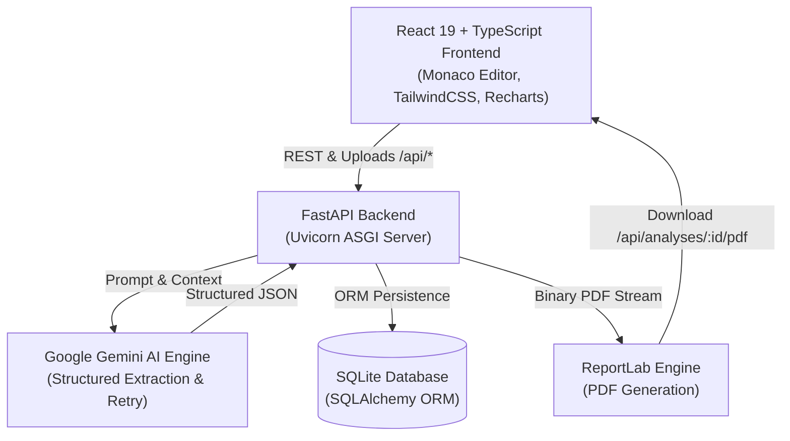

# CodeLens AI 🔍⚡

<p align="center">
  
</p>

<p align="center">
  <strong>Understand. Analyze. Improve. Your Code.</strong><br>
  <em>An enterprise-grade, full-stack AI developer platform for instantaneous source code explanation, security audits, algorithmic complexity derivations, refactoring, and automated documentation.</em>
</p>

<p align="center">
  
  
  
  
  
  
  
  
</p>

---

## 📑 Table of Contents

- [🌟 Overview](#-overview)
- [✨ Key Features](#-key-features)
  - [1. Monaco Code Editor & Multi-Language Support](#1-monaco-code-editor--multi-language-support)
  - [2. Multi-Vector AI Analysis Suite](#2-multi-vector-ai-analysis-suite)
  - [3. Intelligent Refactoring Studio](#3-intelligent-refactoring-studio)
  - [4. Automated Documentation Generator](#4-automated-documentation-generator)
  - [5. Grounded Interactive AI Chat](#5-grounded-interactive-ai-chat)
  - [6. Engineering Analytics Dashboard](#6-engineering-analytics-dashboard)
  - [7. Persistent History & Search](#7-persistent-history--search)
  - [8. Professional Export Pipeline (PDF & Markdown)](#8-professional-export-pipeline-pdf--markdown)
  - [9. Adaptive Dark / Light / System Theming](#9-adaptive-dark--light--system-theming)
- [🛡️ Security & Zero-Execution Policy](#️-security--zero-execution-policy)
- [🏛️ System Architecture](#️-system-architecture)
- [📁 Project Structure](#-project-structure)
- [⚡ Quick Start: Single-File Launchers](#-quick-start-single-file-launchers-recommended)
- [🛠️ Manual Step-by-Step Installation](#️-manual-step-by-step-installation)
- [⚙️ Environment Configuration](#️-environment-configuration)
- [🔌 RESTful API Reference](#-restful-api-reference)
- [🧪 Running the Test Suite](#-running-the-test-suite)
- [🤝 Contributing](#-contributing)
- [📄 License](#-license)

---

## 🌟 Overview

**CodeLens AI** bridges the gap between raw source code and deep engineering comprehension. Designed with a clean, friction-free developer experience:

- **Direct Access**: No mandatory sign-up, passwords, or authentication hurdles. Open the application and start analyzing code immediately.
- **Deep Insights**: Analyzes syntax, control flow, Big-O computational bounds, security vulnerabilities (OWASP Top 10), and actionable code smells.
- **Production Standard**: Backed by Python FastAPI on the server side and React 19 + TypeScript + Monaco Editor on the frontend.

---

## ✨ Key Features

### 1. Monaco Code Editor & Multi-Language Support
- **Industrial Editor**: Embedded Microsoft Monaco Editor with line numbering, bracket matching, code folding, minimap, and font size scaling (12px – 20px).
- **Supported Languages**: Full syntax highlighting and AST awareness for:
  - 🐍 **Python** (`.py`)
  - ☕ **Java** (`.java`)
  - ⚡ **JavaScript** (`.js`)
  - 🔷 **C & C++** (`.c`, `.cpp`, `.cc`, `.h`, `.hpp`)
  - 🌐 **HTML & CSS** (`.html`, `.css`)
  - 🗄️ **SQL** (`.sql`)
- **Direct File Drag & Drop**: Upload source files directly with instant MIME and byte-level validation.
- **Randomized Code Samples**: Pre-loaded with battle-tested algorithmic implementations (LRU Cache, Binary Search Trees, Token Bucket Rate Limiters, Secure JWT middleware, etc.).

### 2. Multi-Vector AI Analysis Suite
Powered by Google Gemini models with structured JSON schemas and resilient multi-model failover:
- **Executive Summary & Purpose**: High-level semantic explanation of the program's objective, architecture, and core patterns.
- **Line-by-Line Semantic Breakdown**: Fine-grained, block-by-block explanations with interactive line-range tags and Expand/Collapse All controls.
- **Automated Bug & Edge-Case Detection**: Findings tagged by severity (**Critical**, **High**, **Medium**, **Low**), complete with reproduction scenarios and concrete remediations.
- **Security Vulnerability Audit**: Automated scans for SQL Injection, Cross-Site Scripting (XSS), Command Injections, hardcoded secrets, and unsafe deserialization.
- **Algorithmic Complexity ($O$ Analysis)**: Exact derivations for **Time Complexity** ($O(1)$, $O(\log n)$, $O(n)$, $O(n^2)$, etc.) and **Space Complexity** with Big-O spectrum ratings.
- **Code Quality Radar Score**: Quantitative 0–100 quality score derived from 4 key sub-metrics:
  - 📖 *Readability*
  - 🔧 *Maintainability*
  - ⚡ *Efficiency*
  - 🔒 *Security*
- **Performance & Optimization Guidance**: Side-by-side comparative suggestions highlighting algorithmic bottlenecks and memory savings.

### 3. Intelligent Refactoring Studio
- Generates clean, production-grade refactored code following modern idioms (PEP 8, ES2024, Clean Architecture).
- **Split Diff Viewer**: Side-by-side or stacked diff viewer showing exact additions, removals, and modifications.
- One-click **Copy to Clipboard** and **Download Refactored Code**.

### 4. Automated Documentation Generator
- Instantly creates publication-ready README and technical documentation in GitHub Flavored Markdown.
- Generates detailed component outlines, parameters & return type tables, error handling expectations, and usage snippets.

### 5. Grounded Interactive AI Chat
- Built-in conversational assistant grounded specifically in the currently active source code and analysis results.
- Context-aware multi-turn conversational history for targeted debugging and architectural inquiries.

### 6. Engineering Analytics Dashboard
- **KPI Metrics**: Real-time counters for Total Analyses, Average Quality Score, Security Issues Flagged, and Total Lines Analyzed.
- **Interactive Visualizations (Recharts)**:
  - *Quality Score Progression*: Area chart tracking code improvements over time.
  - *Language Distribution*: Doughnut/pie chart visualizing language diversity across your workspace.
- **Recent Analyses Carousel**: Quick-jump cards to resume previous sessions.

### 7. Persistent History & Search
- SQLite persistence through SQLAlchemy ORM.
- **Comprehensive Filtering**: Filter historical runs by programming language, minimum quality score, and security alert status.
- **Search & Management**: Live search by snippet title, inline renaming, export, and deletion.

### 8. Professional Export Pipeline (PDF & Markdown)
- **ReportLab PDF Export**: Downloads clean, styled PDF reports complete with headers, summary metrics, quality rings, tables, and formatted source code.
- **Markdown Export**: Generates raw `.md` files perfect for adding directly to GitHub repositories or internal engineering wikis.

### 9. Adaptive Dark / Light / System Theming
- Seamless color palette switching using dynamic CSS variables.
- Monaco Editor responds synchronously, toggling smoothly between `codelens-dark` and `codelens-light`.

---

## 🛡️ Security & Zero-Execution Policy

CodeLens AI strictly adheres to safe, read-only static code analysis:

- ❌ **Zero Dynamic Execution**: Source code is never executed. `eval()`, `exec()`, `subprocess`, or Docker runtime invocations are strictly prohibited on user code.
- 🔒 **File Sanitization**: Uploaded files are decoded as UTF-8 plain text with null-byte rejection.
- 📏 **Size Limits**: Enforced 1MB upload limit and 50,000-character ceiling to prevent resource exhaustion.
- 🛡️ **Defensive Headers**: Built-in middleware enforces `X-Content-Type-Options: nosniff`, `X-Frame-Options: DENY`, and Content Security Policies.

---

## 🏛️ System Architecture



---

## 📁 Project Structure

```
AI code explainer/
├── backend/
│   ├── app/
│   │   ├── api/
│   │   │   ├── analyses.py       # POST /api/analyses/analyze, /upload, CRUD /analyses
│   │   │   ├── tools.py          # /api/explain, /api/refactor, /api/document, /api/chat
│   │   │   ├── dashboard.py      # GET /api/dashboard metrics & distributions
│   │   │   └── export.py         # GET /api/analyses/{id}/pdf and /markdown
│   │   ├── core/
│   │   │   ├── config.py         # Pydantic BaseSettings, CORS, rate limits
│   │   │   ├── security.py       # SecurityHeadersMiddleware & input sanitization
│   │   │   └── exceptions.py     # Custom structured exception handlers
│   │   ├── database/
│   │   │   ├── session.py        # SQLAlchemy SQLite engine & sessionmaker
│   │   │   └── base.py           # Declarative ORM base
│   │   ├── models/
│   │   │   └── analysis.py       # AnalysisModel ORM schema
│   │   ├── schemas/
│   │   │   ├── analysis.py       # Pydantic schemas (requests, responses, results)
│   │   │   ├── chat.py           # AI Chat message schemas
│   │   │   └── dashboard.py      # Dashboard analytics schemas
│   │   ├── services/
│   │   │   ├── ai_service.py     # High-level AI facade
│   │   │   ├── gemini_service.py # Gemini API integration with failover & retry
│   │   │   ├── pdf_service.py    # ReportLab PDF styling & export engine
│   │   │   └── markdown_service.py # GitHub Flavored Markdown builder
│   │   ├── utils/
│   │   │   ├── file_validator.py # Extension checks, size limit, plain-text decode
│   │   │   └── language_map.py   # Normalized language mappings
│   │   └── main.py               # FastAPI entry point & exception handlers
│   ├── tests/
│   │   ├── test_api.py           # CRUD, PDF & Markdown export, dashboard tests
│   │   └── test_validator.py     # Language & sanitizer unit tests
│   ├── .env.example              # Environment variables template
│   ├── requirements.txt          # Python dependencies
│   └── conftest.py               # Pytest configuration
│
├── frontend/
│   ├── src/
│   │   ├── components/
│   │   │   ├── layout/           # Navbar, Footer
│   │   │   ├── editor/           # MonacoCodeEditor, EditorToolbar, LanguageSelector, FileUploader
│   │   │   ├── analysis/         # AnalysisTabs, OverviewTab, ExplanationTab, BugsTab,
│   │   │   │                     # SecurityTab, ComplexityTab, QualityTab, OptimizationTab,
│   │   │   │                     # RefactorTab, DocumentationPanel, ChatPanel
│   │   │   ├── settings/         # SettingsModal
│   │   │   └── ui/               # ScoreRing, LoadingProgress, Toast, Badge, Modal
│   │   ├── context/              # ThemeContext (Dark/Light/System), SettingsContext
│   │   ├── pages/                # LandingPage, AnalyzerPage, DashboardPage, HistoryPage
│   │   ├── services/             # api.ts (Typed HTTP API client)
│   │   ├── types/                # TypeScript interfaces & analysis contracts
│   │   ├── utils/                # Language samples & mappings
│   │   ├── App.tsx               # Root component with routing
│   │   ├── main.tsx              # React DOM entry point
│   │   └── index.css             # Tailwind CSS tokens & dark theme variables
│   ├── package.json
│   ├── tailwind.config.js
│   ├── tsconfig.json
│   └── vite.config.ts
│
├── run.py                        # Cross-platform single-file launcher
├── run.bat                       # Windows double-click launcher
├── run.ps1                       # PowerShell one-click launcher
├── sample_algorithms.py          # Sample Python algorithms for testing
├── sample_auth_service.js        # Sample JavaScript authentication code
├── sample_database_queries.sql   # Sample SQL schema & transaction queries
└── README.md
```

---

## ⚡ Quick Start: Single-File Launchers (Recommended)

Run both the FastAPI backend (`http://127.0.0.1:8000`) and Vite frontend (`http://localhost:5173`) simultaneously using any single launcher:

### Option 1: Python Single File (Cross-Platform)
```bash
python run.py
```

### Option 2: Windows Double-Click
Simply double-click **`run.bat`** in Windows File Explorer.

### Option 3: PowerShell
```powershell
.\run.ps1
```

> **What the launcher handles automatically:**
> 1. Validates Python (3.9+) and Node.js (`npm`) installations.
> 2. Auto-creates `backend/.env` from `.env.example` if not present.
> 3. Runs `npm install` automatically if `frontend/node_modules` is missing.
> 4. Launches both services in parallel with color-tagged logs (`[Backend]`, `[Frontend]`).
> 5. Automatically opens your default web browser to **`http://localhost:5173`**.
> 6. Gracefully shuts down both background process trees when you press `Ctrl+C`.

---

## 🛠️ Manual Step-by-Step Installation

If you prefer to run services manually in separate terminals:

### Prerequisites
- **Python**: Version `3.9` or higher (3.12+ recommended)
- **Node.js**: Version `18.0.0` or higher (`npm` included)

### 1. Backend Setup
```bash
# Navigate to backend folder
cd backend

# Create and activate a virtual environment (optional but recommended)
python -m venv venv
# On Windows:
venv\Scripts\activate
# On Linux/macOS:
source venv/bin/activate

# Install backend dependencies
pip install -r requirements.txt

# Configure your environment
cp .env.example .env
# Edit .env and supply your GEMINI_API_KEY

# Start the FastAPI server
python -m uvicorn app.main:app --reload --port 8000
```
Backend API will be running at `http://127.0.0.1:8000`.

### 2. Frontend Setup
```bash
# Open a new terminal and navigate to frontend folder
cd frontend

# Install npm packages
npm install

# Start Vite development server
npm run dev
```
Frontend UI will be running at `http://localhost:5173`.

---

## ⚙️ Environment Configuration

Backend configuration is managed via `backend/.env`. A template is provided in `backend/.env.example`:

| Variable | Type | Default | Description |
| :--- | :--- | :--- | :--- |
| `GEMINI_API_KEY` | `string` | *(empty)* | **Required**. Your Google Gemini API Key from Google AI Studio. |
| `DATABASE_URL` | `string` | `sqlite:///./codelens.db` | SQLAlchemy connection string (SQLite by default; supports PostgreSQL). |
| `ENVIRONMENT` | `string` | `development` | Deployment environment (`development` or `production`). |
| `CORS_ORIGINS` | `string` | `http://localhost:5173,...` | Comma-delimited list of permitted CORS frontend origins. |
| `RATE_LIMIT_PER_MINUTE` | `int` | `60` | Request rate limiter threshold per IP per minute. |

### How to get a Gemini API Key:
1. Visit [Google AI Studio](https://aistudio.google.com/).
2. Sign in with your Google account.
3. Click **"Get API Key"** and create a free API key.
4. Paste your key into `backend/.env`:
   ```env
   GEMINI_API_KEY=AIzaSyYourActualKeyHere
   ```

*(Note: Even without an API key immediately configured, CodeLens AI launches smoothly and provides friendly in-app guidance on where to enter your key).*

---

## 🔌 RESTful API Reference

The FastAPI backend automatically provides interactive OpenAPI documentation at **`http://127.0.0.1:8000/docs`** (Swagger UI) and **`http://127.0.0.1:8000/redoc`** (ReDoc).

### Analysis Endpoints
| Method | Endpoint | Description |
| :--- | :--- | :--- |
| `POST` | `/api/analyses/analyze` | Submit source code and language for comprehensive multi-vector AI analysis. |
| `POST` | `/api/analyses/upload` | Upload a raw source code file (max 1MB). Returns language and decoded text. |
| `GET` | `/api/analyses` | Query stored analyses with optional search, language, and score filters. |
| `GET` | `/api/analyses/{id}` | Retrieve full analysis results and source code for a specific record. |
| `PUT` | `/api/analyses/{id}` | Update the title or metadata of a saved analysis. |
| `DELETE`| `/api/analyses/{id}` | Permanently delete an analysis from history. |

### AI Utility Tools
| Method | Endpoint | Description |
| :--- | :--- | :--- |
| `POST` | `/api/explain` | Generate targeted code explanation at specified detail levels (`brief`, `balanced`, `deep`). |
| `POST` | `/api/refactor` | Refactor code targeting clean architecture, efficiency, or readability with diff markers. |
| `POST` | `/api/document` | Automatically generate a complete technical README in Markdown. |
| `POST` | `/api/chat` | Interactive multi-turn chat grounded in the provided source code and analysis. |

### Analytics & Exports
| Method | Endpoint | Description |
| :--- | :--- | :--- |
| `GET` | `/api/dashboard` | Retrieve workspace stats, quality score progression, and language distribution. |
| `GET` | `/api/analyses/{id}/pdf` | Download a publication-grade PDF report of the analysis. |
| `GET` | `/api/analyses/{id}/markdown` | Download a clean Markdown report of the analysis. |
| `GET` | `/api/health` | Service health check and verification of Gemini API key presence. |

---

## 🧪 Running the Test Suite

### Backend Unit & Integration Tests
The backend includes automated tests covering API endpoints, CRUD operations, file validation, sanitization, and export pipelines:

```bash
# From the project root
python -m pytest backend -v
```

### Frontend Typecheck & Build
Verify TypeScript compilation and bundle integrity:

```bash
cd frontend
npm run build
```

---

## 🤝 Contributing

Contributions, bug reports, and feature requests are welcome!

1. **Fork the repository** on GitHub.
2. **Create a feature branch**:
   ```bash
   git checkout -b feature/amazing-feature
   ```
3. **Commit your changes**:
   ```bash
   git commit -m "Add amazing new feature"
   ```
4. **Push to the branch**:
   ```bash
   git push origin feature/amazing-feature
   ```
5. **Open a Pull Request**.

---

## 📄 License

This project is licensed under the **MIT License** — see the [LICENSE](LICENSE) file for details.

---

<p align="center">
  Built with ❤️ for developers by developers. Powered by <strong>Google Gemini</strong>.
</p>
